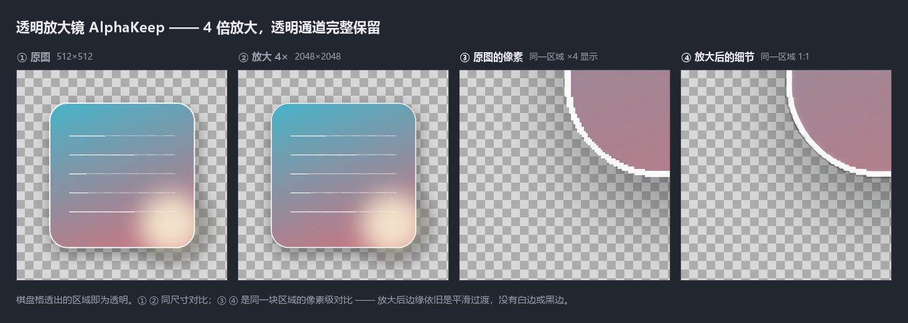

# 透明放大镜 AlphaKeep

**中文** ｜ [English](#english)


把 AI 放大做到**双击就能用**，而且**不丢透明通道**。

> 手上有几十张带透明背景的立绘 / 素材，想放大 4 倍拿去用。
> 搜到 Real-ESRGAN，装 conda、配 CUDA、敲一长串命令，跑起来还爆显存 ——
> 折腾两小时，一张图没出来。

这个项目就是把那段过程压成三步。

---

<!--
  强烈建议放一张对比图在这里。最有说服力的形式：
  左：原图（透明底，配棋盘格背景）；右：放大 4 倍后（同样棋盘格，透明仍在）。
  一定要用棋盘格 —— 白底看不出透明有没有被保住。

  
-->

## 三步开始

```text
1. 双击  安装Python环境.bat      ← 只在新机器上需要做一次
2. 双击  下载模型.bat            ← 约 6.5 GB，支持断点续传
3. 双击  一键放大.bat            ← 浏览器自动打开，拖图，点「开始」
```

第 3 步会起一个本地网页界面（只监听 `127.0.0.1`），在里面可以：

- **拖图进虚线框** → 进入待处理列表，点「开始」才动手
- 或者点 **「选择图片文件…」** → 弹 Windows 原生文件框，结果写到**原图旁边**
- 调放大倍率 `x1`~`x4`、输出格式、显存模式
- 看实时进度、随时取消（一个瓦片内生效）
- 所有选项会自动记住，下次打开还在

---

## 它解决什么

| 问题 | 这里怎么处理 |
|---|---|
| 放大后透明通道没了 | alpha 单独走一条放大路径，最后合成回 RGBA |
| 显存不够直接报错 | 按显存自动选分块；爆了自动降档重试（384→256→192） |
| 跑完内存不释放 | 每张跑完立即还内存；退出时全部归还 |
| 只能出 PNG | PNG / WebP / JPEG 任选，也能「与原图格式相同」 |
| 命令行劝退 | 双击开浏览器界面，拖图 + 点按钮 |

关于透明多说一句：**很多在线工具和简单脚本会把透明区域填成黑底或白底**。
本项目的做法是把 alpha 拆出来单独放大、再合回去 ——
思路和 Real-ESRGAN 的 `--alpha_upsampler` 是同一类，这也是这个领域里的通行解法。

---

## 特点

**🖱 不用装环境、不用敲命令**<br>
双击出浏览器界面。选文件夹、拖图、点开始，就这三步。

**💧 透明不丢**<br>
PNG / WebP 的 alpha 通道单独放大，最后合回 RGBA。
输出 WebP 时透明同样保留。

**📉 小显存也能跑**<br>
按显存容量自动选分块；显存不足会自动降档重试，不会直接甩一堆报错给你。

**🧹 跑完就还内存**<br>
每批处理完释放模型和缓存，进程内存回落到几十 MB；
点「退出程序」或关掉窗口，整块内存全部归还。

**🧠 记得你的选择**<br>
文件夹、倍率、格式、分块大小都会记住，下次打开还是上次那套。

---

## 支持格式

| 输入 | 输出 |
|---|---|
| PNG、JPEG（`.jpg` / `.jpeg`）、WebP | PNG、WebP、JPEG，或「与原图格式相同」 |

- **PNG / WebP** 支持透明
- **JPEG** 不支持透明，透明区域会铺成白底（可改成黑底）
- 没有 alpha 的图会按**不透明**处理，不会跳过

---

## 系统要求

| 项目 | 要求 |
|---|---|
| 系统 | Windows 10 / 11（64 位） |
| 显卡 | **NVIDIA + CUDA**。AMD / Intel 核显 / macOS 不支持 |
| 显存 | 6 GB 起；8 GB 可处理大图 |
| 内存 | 16 GB 建议（处理 1 亿像素的图时峰值约 12 GB） |
| 硬盘 | 10 GB（权重 6.5 GB + 运行时） |
| Python | **不用自己装**，`安装Python环境.bat` 会配好 |

---

## 模型权重

权重约 **6.5 GB**，**不包含在本仓库中**，需要自己下载：

```powershell
双击 下载模型.bat
# 或者
python scripts/download_weights.py
```

脚本会：

- 从 [ModelScope](https://modelscope.cn/models/LULALULALU/VOSR_CKPT) 拉取（国内快）
- 支持**断点续传**，网断了重跑从断点继续
- 下完做 **SHA256 校验**
- 已存在且校验通过就跳过

想走 Hugging Face：

```powershell
下载模型.bat --mirror hf
```

只校验不下载：

```powershell
下载模型.bat --check
```

---

## 命令行用法

不想用界面也可以：

```powershell
一键放大.bat                 # 处理 vosr2_input，x4
一键放大.bat -u 2            # 2 倍
一键放大.bat -f webp         # 输出 WebP
一键放大.bat --list          # 干跑，只列出会处理哪些图
一键放大.bat --help          # 全部参数
```

---

## 已知限制

- 只支持 **NVIDIA + CUDA**；AMD / Intel / macOS 跑不了
- 是**生成式**放大，会重绘细节，**不是无损放大**
- 处理 1 亿像素的图需要 16 GB 内存，内存不足会失败
- 首次运行要加载 5 GB 权重，约 10 秒（之后每批重新加载）
- B 站专栏等平台对单图有体积上限，出图后可能需要二次压缩

---

## 常见问题

**双击没反应 / 闪一下就没了**

没找到 Python。窗口里会有提示，检查是不是放在了一个没装 Python 的目录，或者先跑 `安装Python环境.bat`。

**报显存不足**

程序会自动降档重试。如果四档都试完还是失败，把别的占显卡的程序关掉（浏览器硬件加速、游戏、录屏），或者把倍率降到 `x2`。

**报内存不足**

大图需要 16 GB 以上内存。可以先关掉浏览器，或者用 `-u 2`。

**透明没保住**

确认输出格式不是 JPEG —— JPEG 格式本身没有 alpha 通道。要透明请选 PNG 或 WebP。

**跑完内存没降**

图形界面的服务进程会一直活着。点界面里的**「退出程序」**，或者直接关掉那个黑色命令行窗口，内存就全还回去了。

---

## 许可与致谢

本仓库的**代码**采用 [Apache-2.0](LICENSE)，衍生自下面两个同为 Apache-2.0 的项目：

- [ComfyUI-VOSR2](https://github.com/ylchen333/ComfyUI-VOSR2) — 把 VOSR 接入 ComfyUI 的节点包
- [VOSR](https://github.com/cswry/VOSR) — CVPR 2026，一步式 1.4B DiT 超分模型

推理链路由 VOSR 2.0（1.4B 一步式 DiT）+ Qwen-Image VAE + DINOv2-L 组成。

**模型权重**不随本仓库分发，其版权与许可归原作者所有：

- VOSR 2.0 权重 — <https://huggingface.co/CSWRY/VOSR>
- DINOv2 权重 — <https://github.com/facebookresearch/dinov2>
- Qwen-Image VAE — <https://huggingface.co/Qwen>

> 本项目是 VOSR 2.0 的**第三方封装**，与 VOSR 作者及 Meta 无关联、未获其背书。

---

<a id="english"></a>

## English

**English** ｜ [中文](#透明放大镜-alphakeep)

### AlphaKeep — a transparent-image upscaler for Windows

One-click AI upscaling for **transparent** PNG / WebP art. Powered by VOSR 2.0.

> You have dozens of character portraits with transparent backgrounds and want them
> 4× larger. You find Real-ESRGAN, install conda, fight with CUDA, type a wall of
> commands — and it runs out of VRAM. Two hours gone, zero images produced.

This project compresses that whole process into three steps.

### Quick start

```text
1. Double-click  安装Python环境.bat   (install Python — only needed once, on a new machine)
2. Double-click  下载模型.bat         (download weights, ~6.5 GB, resumable)
3. Double-click  一键放大.bat         (opens a local browser UI)
```

> The `.bat` filenames are in Chinese — keep them as-is, they are the actual file names.

Step 3 starts a local web UI bound to `127.0.0.1` only. In it you can:

- **Drag images onto the dashed box** — they queue up; nothing runs until you click Start
- Or click **"选择图片文件…"** to open a native Windows file picker; results are written
  **next to each source image**
- Pick scale (`x1`–`x4`), output format, and VRAM mode
- Watch live progress and cancel at any time (within one tile)
- Every setting is remembered for next time

### What it solves

| Problem | How it is handled |
|---|---|
| Alpha channel lost after upscaling | Alpha is upscaled on a separate path and composited back to RGBA |
| Runs out of VRAM and crashes | Tile size is chosen from available VRAM; on OOM it downgrades and retries |
| Memory never released | Released after every batch, and fully on exit |
| PNG-only output | PNG / WebP / JPEG, or "match the source format" |
| Command-line barrier | Browser UI launched by double-click |

On transparency: **many online tools and simple scripts flatten transparent areas onto
black or white.** This project splits alpha out, upscales it separately and composites it
back — the same family of approach as Real-ESRGAN's `--alpha_upsampler`.

### Supported formats

| Input | Output |
|---|---|
| PNG, JPEG (`.jpg` / `.jpeg`), WebP | PNG, WebP, JPEG, or "same as source" |

PNG and WebP keep transparency. JPEG cannot, so transparent areas are flattened onto white
(configurable to black). Images without alpha are treated as fully opaque rather than skipped.

### Requirements

| Item | Requirement |
|---|---|
| OS | Windows 10 / 11 (64-bit) |
| GPU | **NVIDIA with CUDA**. AMD / Intel iGPU / macOS are not supported |
| VRAM | 6 GB minimum; 8 GB handles large images |
| RAM | 16 GB recommended (~12 GB peak on 100-megapixel images) |
| Disk | 10 GB (6.5 GB of weights plus the runtime) |
| Python | **Not required separately** — `安装Python环境.bat` sets it up |

### Model weights

About **6.5 GB**, **not bundled with this repository**:

```powershell
下载模型.bat                    # from ModelScope (fast in mainland China)
下载模型.bat --mirror hf        # from Hugging Face instead
下载模型.bat --check            # verify what is already downloaded
```

The downloader supports resuming, verifies SHA256 for each file, and skips files that are
already complete.

### Known limitations

- NVIDIA + CUDA only; no AMD, Intel, or macOS support
- **Generative** upscaling — it redraws detail, it is **not** lossless
- 100-megapixel images need 16 GB of RAM
- Loading the 5 GB of weights takes ~10 seconds per run
- Platforms like Bilibili impose per-image size limits, so you may need to compress outputs

### FAQ

**Nothing happens when I double-click.** No Python was found. Check the message printed in
the window, or run `安装Python环境.bat` first.

**Out of VRAM.** It downgrades automatically. If all four tiers fail, close other GPU-heavy
apps (browser hardware acceleration, games, screen recorders), or drop to `x2`.

**Out of RAM.** Very large images need 16 GB+. Close the browser, or use `-u 2`.

**Transparency is gone.** Make sure the output format isn't JPEG — JPEG has no alpha channel.

**Memory doesn't drop after finishing.** The GUI is a long-running server. Click **"退出程序"**
in the UI, or close the console window, and everything is returned.

### License and credits

The **code** in this repository is [Apache-2.0](LICENSE), derived from two Apache-2.0 projects:

- [ComfyUI-VOSR2](https://github.com/ylchen333/ComfyUI-VOSR2)
- [VOSR](https://github.com/cswry/VOSR) (CVPR 2026, one-step 1.4B DiT super-resolution)

Inference uses VOSR 2.0 (1.4B one-step DiT) + the Qwen-Image VAE + DINOv2-L.

**Model weights are not distributed with this repository.** Their copyright and licensing
belong to their respective authors:

- VOSR 2.0 weights — <https://huggingface.co/CSWRY/VOSR>
- DINOv2 weights — <https://github.com/facebookresearch/dinov2>
- Qwen-Image VAE — <https://huggingface.co/Qwen>

> This is an **unofficial third-party wrapper**. It is not affiliated with or endorsed by
> the VOSR authors or Meta.
